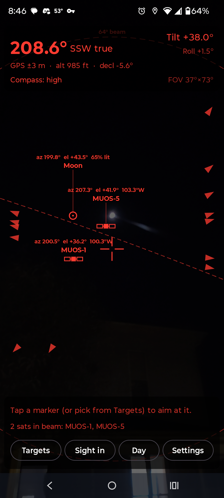

# AR Antenna Aligner

**Point your phone at the sky or the horizon and see where every tower, repeater and satellite actually is.**

An Android app for aiming directional antennas. It overlays world-locked markers on the camera view
showing the true bearing, elevation and distance to RF targets: police and fire towers, cell sites,
repeaters, airports, geostationary satellites, the Sun and the Moon. Think of a star-gazing app, but
for antennas.

No account, no ads, no API keys. Works offline once your targets are loaded.

<p align="center">
  
</p>

## What it does

- **Antennas near any US ZIP code.** Type a ZIP, pick 10 / 25 / 50 / 75 / 100 miles, and the app
  fills in every antenna site the FCC has on file in that circle: about 490,000 sites nationwide,
  each with its users, frequencies, call signs and height.
- **Categories.** Every site is sorted into police/fire/EMS, government, railroad, utilities,
  schools, hospitals, farm, cell and towers, broadcast, paging, microwave or other business.
  Hide or show a whole group with one tap.
- **Live AR view.** Markers stay glued to the real tower as you pan. Off-screen targets you have
  selected get an arrow at the screen edge.
- **Aiming guidance.** Select a target and the panel reads "Turn right 12.3° · Tilt up 0.4°". The
  crosshair turns green and the phone ticks when you are within 1.5°.
- **Beamwidth circle.** Set your antenna's beamwidth and see what falls inside the main lobe.
- **Geostationary satellites.** Current positions from CelesTrak, the geostationary belt drawn
  across the sky, and for inclined satellites the daily figure-8 with the point a fixed antenna
  should aim at.
- **Sun and Moon.** Live markers, and a one-tap compass calibration against the Sun.
- **Browse mode.** Drag the view to look around without turning the phone; tap Recenter to go back
  to the live camera.
- **Night mode, portrait and landscape, imperial or metric.**

## Install

1. Download the APK from the [latest release](../../releases/latest).
2. Open it on the phone and allow "install unknown apps" when asked.
3. Grant camera and location when the app starts.

Requires Android 8.0 or newer and a phone with a compass. The APK is signed with a debug key, so
Android will warn that it is from an unknown developer.

## Quick start

1. **Wait for GPS.** The header shows `GPS ±3 m` once you have a fix.
2. **Check the compass.** If the header says `Compass: low`, wave the phone in a figure-8.
3. **Load your area.** Targets → **Add antennas near a ZIP code**. Pick a radius and what to
   include. (The app ships with Rush County, Indiana preloaded. Targets → **Clear** removes it.)
4. **Sight in.** Tap **Sight in → ☀ Use the Sun**, put the crosshair on the Sun's glare, tap
   **Set on target**. Never look at the Sun directly; just center the bright spot on the screen.
   At night use the Moon, or any tower you can see.
5. **Aim.** Tap a marker, or pick one from Targets. Follow the guidance until the crosshair is green.

Step 4 matters. A phone compass is commonly 5–15° off even when it reports "high" accuracy, and
metal nearby (a roof, a mast, a vehicle) shifts it. Sighting in on something whose position is
known exactly removes that error. Do it standing where you will aim from.

## Adding antennas for an area

**Targets → Add antennas near a ZIP code**

| Option | What it adds |
|---|---|
| Registered towers | Structures in the FCC tower registry: cell towers, broadcast towers, tall masts |
| Police, fire, EMS, government | Public-safety radio licences with a fixed site |
| Business, utility, school, railroad | Other land-mobile licences with a fixed site |
| Microwave-only link sites | Places that only hold point-to-point microwave licences |

A site that fits several categories is added if any of them is ticked. Sites already in your list
are skipped, so you can add overlapping areas. You can use your GPS position instead of a ZIP.

Typical counts with everything except microwave ticked:

| Around | 25 miles | 75 miles |
|---|---|---|
| Rural Montana | about 60 | about 270 |
| Rushville, Indiana | about 420 | about 6,200 |
| Indianapolis | about 1,270 | about 4,700 |
| New York City | about 6,100 | about 13,700 |

A single add is capped at the nearest 10,000 sites. With a long list, **Settings → Show towers
within** limits how far out markers are drawn, and the Targets list has a search box that matches
names, frequencies and call signs.

### Hiding and showing categories

Tap **Filter** in the camera view, or use the row of category buttons at the top of Targets. Each
shows how many sites it holds. A site used by several groups (a county tower that also carries a
cell carrier) stays on while any of its categories is on, and the target you are aiming at always
shows. Targets you typed in yourself are under **My own**.

The FCC only separates public safety from everything else. The finer groups are worked out from
the licensee's name and, for railroads, from the band reserved for them (160.215–161.565 MHz).
Railroads, schools, hospitals and utilities sort well. A business with a name that gives nothing
away lands in **Other business**, and a county licence is filed under police/fire/EMS even when
the radio on it belongs to the highway department.

### What the data is, and what it is not

Sites are built from the FCC's public bulk files (Universal Licensing System and Antenna Structure
Registration). Licences and registrations within 80 m of each other are merged into one marker.

- **Coordinates are whatever the licensee filed.** Most are good. Some are hundreds of metres off.
  If a marker does not sit on its tower, edit the target and fix it.
- **Not included:** amateur (ham) repeaters, FM/TV broadcast transmitters unless the tower is
  registered, receive-only antennas, federal government sites, and cell antennas on structures
  that are neither registered nor hold a microwave licence.
- **US only** (50 states, Puerto Rico, US Virgin Islands).

You can also add targets by hand, paste coordinates in decimal or FCC format
(`39-36-26.2 N 85-26-37.9 W`), or import JSON/CSV. Export shares your list as JSON.

## Satellites

**Targets → Satellites.** Orbit data is CelesTrak's public geostationary group; a snapshot ships
with the app and **Update from CelesTrak** refreshes it.

- Toggle any satellite into the view. Its marker sits at its current position.
- The dashed arc is the geostationary belt as seen from where you stand.
- Selecting a satellite draws its path over the next 24 hours. Older satellites run low on fuel
  and are left to drift north and south, tracing a daily figure-8. The **+ aim (daily center)**
  mark is where a fixed antenna should point, and the guidance uses it.
- The bottom panel counts satellites inside your beam circle.

Satellites below your horizon are not shown, because you cannot receive them.

This is a receive-side aiming aid. Transmitting on satellite frequencies you are not licensed for
is illegal.

## How accurate is it?

| Part | Accuracy | Checked against |
|---|---|---|
| Bearing, distance, elevation to ground targets | Exact to the input coordinates; 4/3-Earth curvature applied | Closed-form cases in unit tests |
| Geostationary satellites | Better than 0.2° | Skyfield SGP4 |
| Sun | Better than 0.05° | Skyfield with JPL DE421 |
| Moon | Better than 0.5° | Skyfield with JPL DE421 |
| Camera field of view | Read from the phone's own camera metadata | Satellite separation on a real device |
| Compass heading | 5–15° until you sight in | The Moon, on a real device |

The limiting factor is always the phone's compass. Everything else is better than a degree.

If markers slide off their tower as you pan left and right, adjust **Settings → Camera FOV scale**.
Some phones crop the preview for stabilization.

## Privacy

- Your location is used on the phone only. It is never sent anywhere.
- The app makes two kinds of network request, both only when you tap the button:
  - **Update from CelesTrak** downloads the satellite list.
  - **Add antennas near a ZIP code** downloads map squares from this repository's `data` branch.
    Each square covers one degree of latitude and longitude (roughly 70 by 55 miles), so the
    request reveals only that broad area.
- No analytics, no crash reporting. If the app crashes it saves the error on the phone and shows
  it to you on the next launch.

## Build from source

Needs JDK 17+ and the Android SDK (compileSdk 37).

```
gradlew.bat assembleDebug        # APK in app/build/outputs/apk/debug/
gradlew.bat testDebugUnitTest    # unit tests
gradlew.bat lintDebug
```

Create `local.properties` with `sdk.dir=<path to your Android SDK>` if Android Studio has not
already done so.

### Rebuilding the antenna data

The `data` branch holds one gzipped JSON file per 1° cell plus an `index.json`. To regenerate it
from fresh FCC files, see [`tools/README.md`](tools/README.md).

## How it works

| Piece | Where |
|---|---|
| Haversine distance, great-circle bearing, elevation with 4/3-Earth curvature | `geo/GeoMath.kt` |
| World direction → device frame → pinhole projection; heading, pitch, roll; beam cone | `ar/Projector.kt` |
| Focal length in screen pixels from Camera2 metadata, aware of the preview crop | `ar/CameraIntrinsics.kt` |
| Rotation-vector sensor, adaptive smoothing, display-rotation remap | `sensors/OrientationProvider.kt` |
| Fused location, mean-sea-level altitude, live magnetic declination | `sensors/LocationProvider.kt` |
| Satellite positions: Kepler + J2 secular drift, sidereal time, look angles | `sat/OrbitMath.kt` |
| Sun and Moon: Astronomical Almanac low-precision formulas, refraction | `sat/Astro.kt` |
| ZIP lookup, tile download and filtering | `data/AreaRepository.kt` |
| Site categories and the show/hide rule | `data/Category.kt` |
| Overlay drawing and label decluttering | `ui/ArOverlay.kt` |

All paths are under `app/src/main/java/online/rushcounty/aligner/`.

This is sensor-based location AR. It does not use ARCore, so it works on any phone with a compass
and needs no cloud service. True heading = magnetic heading + declination + your sight-in offset.
The original design brief is in [`docs/HANDOFF.md`](docs/HANDOFF.md).

## Known limits

- Geostationary satellites only. Low-orbit satellites (weather satellites, the ISS) need full SGP4
  propagation and pass prediction, which is not built yet.
- No map view for picking a target location; coordinates are typed, pasted or imported.
- Terrain is not considered. A target can be marked above the horizon and still be behind a hill.
- Only tested on one Android 15 phone so far.

## Data sources

- **FCC** Universal Licensing System and Antenna Structure Registration bulk files (US public domain).
- **US Census Bureau** ZIP Code Tabulation Area gazetteer, for ZIP centroids (US public domain).
- **CelesTrak** GP element sets for the geostationary group.
- **OpenStreetMap** for eight towers in the bundled Rush County list that have no FCC record.
  © OpenStreetMap contributors, ODbL.

## License

MIT. See [LICENSE](LICENSE).
